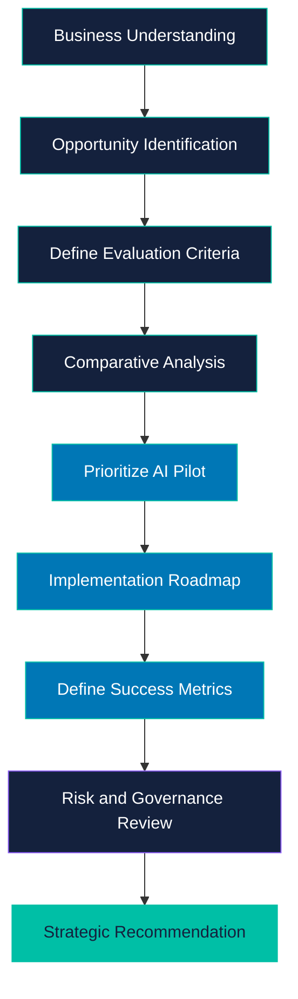

<div align="center">

# AI OPPORTUNITY AND STRATEGY

### A Business-Driven Approach to Artificial Intelligence

**IABAC P101 | AI Business Leader | Retail Case Study**

---

Transforming Business Challenges into Data-Driven AI Opportunities

</div>

---

## 01. Project Overview

Artificial intelligence is transforming how organizations analyze information, understand customers, optimize operations, and make strategic decisions.

However, successful AI adoption begins with identifying the right business problem.

This project explores how Horizon Retail, a fictional retail organization, can identify potential AI opportunities, evaluate business value, compare implementation feasibility, and develop a structured AI adoption strategy.

The objective is to connect business requirements with practical AI applications and establish a framework for making informed investment decisions.

### Project Information

| Attribute        | Details                                       |
| ---------------- | --------------------------------------------- |
| Project Name     | AI Opportunity and Strategy                   |
| Assessment       | IABAC P101                                    |
| Domain           | Artificial Intelligence and Business Strategy |
| Industry         | Retail                                        |
| Project Type     | Business Case Study                           |
| Main Deliverable | Jupyter Notebook                              |
| Repository       | AI_opportunity_and_statergy                   |

---

## 02. Business Problem

Retail organizations generate valuable information through sales, customer interactions, product purchases, and inventory operations.

Turning this information into useful business decisions can be challenging.

Potential business challenges include:

* Understanding customer purchasing behavior.
* Forecasting future product demand.
* Improving customer support efficiency.
* Identifying opportunities for personalized product recommendations.
* Evaluating which AI initiatives should receive investment first.

The central business question is:

**Which AI opportunity should a business prioritize to achieve meaningful business value while managing cost, feasibility, and risk?**

The project addresses this question through structured analysis and strategic planning.

---

## 03. Project Objectives

The primary objective is to develop a business-oriented framework for evaluating AI opportunities.

The project aims to:

1. Identify potential AI applications relevant to retail.
2. Define criteria for comparing candidate initiatives.
3. Evaluate potential business impact and implementation feasibility.
4. Consider costs, operational requirements, and risks.
5. Prioritize an appropriate AI pilot based on the analysis.
6. Develop a phased implementation strategy.
7. Identify suitable performance indicators.
8. Incorporate responsible AI considerations into the recommendation.

---

## 04. AI Opportunity Areas

### 4.1 Demand Forecasting

Predictive analytics can help estimate future product demand using historical sales, seasonal patterns, and other relevant business information.

**Potential business value:** Better-informed inventory and purchasing decisions.

### 4.2 Intelligent Customer Support

Natural language processing can help interpret customer questions and retrieve answers from approved information sources.

A retrieval-augmented generation system could be considered when appropriate, with human escalation for complex or sensitive questions.

**Potential business value:** More efficient handling of routine customer enquiries.

### 4.3 Customer Analytics

Customer segmentation and behavioral analysis can help identify patterns in purchasing activity.

These insights can support customer research, marketing analysis, and business planning.

**Potential business value:** More informed customer engagement strategies.

### 4.4 Product Recommendation Systems

Recommendation algorithms can identify potentially relevant products using suitable purchase histories, product characteristics, and customer interactions.

**Potential business value:** Improved product discovery and personalization.

These are example opportunities. The final recommendation should follow the evidence and results documented in the project notebook.

---

## 05. Project Workflow

The project follows a structured business analysis process, from understanding business needs to presenting a strategic recommendation.



### Workflow Description

| Stage | Activity                         | Intended Outcome          |
| ----- | -------------------------------- | ------------------------- |
| 01    | Understand business requirements | Defined business problem  |
| 02    | Identify AI opportunities        | Candidate initiatives     |
| 03    | Define evaluation criteria       | Assessment framework      |
| 04    | Compare candidate solutions      | Comparative analysis      |
| 05    | Prioritize an initiative         | Recommended pilot         |
| 06    | Plan implementation              | Phased roadmap            |
| 07    | Define success measures          | Evaluation framework      |
| 08    | Review risks                     | Governance considerations |
| 09    | Present the recommendation       | Business strategy         |

---

## 06. Evaluation Framework

AI initiatives should be evaluated using business requirements and implementation constraints rather than technology alone.

| Criterion           | Evaluation Question                                     |
| ------------------- | ------------------------------------------------------- |
| Business Impact     | How important is the problem being addressed?           |
| Feasibility         | Are the necessary data and resources available?         |
| Implementation Cost | What investment may be required?                        |
| Time to Value       | How quickly could the pilot demonstrate useful results? |
| Risk                | What technical, operational, or ethical risks exist?    |
| Scalability         | Can the solution expand if the pilot succeeds?          |

The selected initiative should balance potential business value, implementation feasibility, cost, and risk.

Actual scores, rankings, and recommendations should be taken from the project's analysis rather than assumed in advance.

---

## 07. Implementation Roadmap

The following is an illustrative 90-day implementation plan. The final schedule should reflect the selected initiative and available resources.

### Phase 1 — Discovery and Planning

**Days 1–30**

* Define the business problem.
* Identify relevant data sources.
* Assess data quality and availability.
* Establish baseline performance measures.
* Define pilot success criteria.

### Phase 2 — Development and Validation

**Days 31–60**

* Develop the initial pilot.
* Test the proposed approach.
* Evaluate technical performance.
* Review privacy, security, and reliability.
* Gather stakeholder feedback.

### Phase 3 — Evaluation and Improvement

**Days 61–90**

* Compare results against baseline performance.
* Assess costs and potential business benefits.
* Document limitations and lessons learned.
* Recommend whether to continue, improve, or expand the pilot.

---

## 08. Success Metrics

The success of an AI initiative should be measured against clearly defined business objectives.

| Measurement Area      | Example Metric        |
| --------------------- | --------------------- |
| Demand Forecasting    | Mean Absolute Error   |
| Customer Support      | Average Response Time |
| Customer Support      | Resolution Rate       |
| Recommendations       | Conversion Rate       |
| Operations            | Processing Time       |
| Financial Performance | Return on Investment  |
| Reliability           | System Error Rate     |

The metrics selected should directly reflect the business objective of the chosen pilot.

Potential benefits must be validated using actual results. They should not be presented as achieved outcomes without supporting evidence.

---

## 09. Technology Stack

The following technologies are relevant to notebook-based data analysis and AI strategy work. The exact tools used should be confirmed against the actual notebook implementation.

| Technology       | Purpose                              |
| ---------------- | ------------------------------------ |
| Python           | Data analysis and computation        |
| Jupyter Notebook | Organizing analysis and explanations |
| Pandas           | Data manipulation                    |
| NumPy            | Numerical computation                |
| Matplotlib       | Data visualization                   |
| Git              | Version control                      |
| GitHub           | Project hosting and documentation    |

---

## 10. Project Structure

The current repository contains the main project notebook and its documentation.

```text
AI_opportunity_and_statergy/
|
|-- IABAC_AI_Business_Leader_P101_Attractive.ipynb
|
|-- README.md
|
```

Additional datasets, reports, and supporting files can be included if required by the assessment.

---

## 11. Getting Started

### Prerequisites

* Python installed on your computer.
* Jupyter Notebook.
* Additional Python libraries required by the notebook.

### Step 1: Clone the Repository

```bash
git clone https://github.com/govardhan-goud123/AI_opportunity_and_statergy.git
```

### Step 2: Open the Project Directory

```bash
cd AI_opportunity_and_statergy
```

### Step 3: Install Jupyter Notebook

```bash
pip install notebook
```

### Step 4: Launch Jupyter Notebook

```bash
jupyter notebook
```

### Step 5: Open the Project

Open the following file:

`IABAC_AI_Business_Leader_P101_Attractive.ipynb`

Run the notebook cells in order. Install any additional dependencies required by the project before executing all cells.

---

## 12. Responsible AI and Governance

Responsible AI practices should be considered throughout planning, development, evaluation, and deployment.

| Area            | Recommended Practice                          |
| --------------- | --------------------------------------------- |
| Privacy         | Protect personal and confidential information |
| Security        | Apply appropriate access controls             |
| Fairness        | Evaluate potential bias                       |
| Human Oversight | Retain human review where necessary           |
| Transparency    | Document assumptions and limitations          |
| Monitoring      | Evaluate performance over time                |
| Validation      | Test outputs before operational use           |

AI should support responsible business decision-making rather than replace necessary human judgment.

---

## 13. Key Takeaways

This project emphasizes the importance of connecting AI capabilities with measurable business needs.

The key principles are:

* Start with a clearly defined business problem.
* Evaluate opportunities using consistent criteria.
* Consider data readiness, cost, feasibility, and risk.
* Validate assumptions through a controlled pilot.
* Measure results using relevant business indicators.
* Apply appropriate governance and responsible AI practices.
* Expand successful initiatives based on evidence.

---

## 14. About the Author

**Govardhan Goud**

Aspiring AI and Data Science Professional.

Areas of interest include artificial intelligence, machine learning, natural language processing, data analysis, and practical business applications.

**GitHub Profile:**
https://github.com/govardhan-goud123

---

<div align="center">

**AI STRATEGY | BUSINESS INTELLIGENCE | DATA-DRIVEN DECISION MAKING**

*Turning business questions into structured analytical decisions.*

</div>
