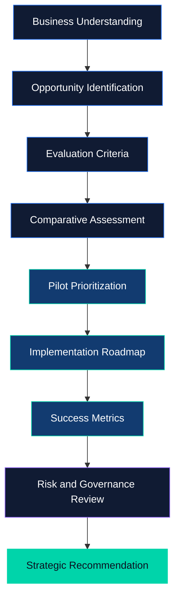

<div align="center">


<br/>


<br/><br/>

<a href="https://github.com/govardhan-goud123/AI_opportunity_and_statergy">

</a>


<br/><br/>

**An analytical case study on identifying, evaluating, and prioritizing artificial intelligence opportunities for business growth.**

[Project Notebook](./IABAC_AI_Business_Leader_P101_Attractive.ipynb)   |   [Author Profile](https://github.com/govardhan-goud123)

</div>

---

## Project Overview

Artificial intelligence is transforming the way organizations analyze information, understand customers, optimize operations, and make strategic decisions.

However, successful AI adoption requires more than choosing a model or implementing a new technology. Organizations must first understand their business challenges, evaluate opportunities, assess feasibility, and define measurable outcomes.

**AI Opportunity and Strategy** explores this decision-making process through a business case study involving Horizon Retail, a fictional retail organization.

The project focuses on connecting business requirements with potential AI solutions and developing a structured approach to selecting and implementing an appropriate AI initiative.

<div align="center">


</div>

## The Business Challenge

Retail organizations generate valuable information through sales, customer interactions, product purchases, and inventory operations. Converting this information into actionable decisions can be challenging.

Potential business challenges include:

| Business Area         | Challenge                                  | Potential AI Application                  |
| --------------------- | ------------------------------------------ | ----------------------------------------- |
| Demand Planning       | Uncertainty in future product demand       | Predictive forecasting                    |
| Customer Experience   | Repetitive customer questions              | NLP-based support assistant               |
| Customer Intelligence | Difficulty identifying purchasing patterns | Customer segmentation                     |
| Product Discovery     | Difficulty recommending relevant products  | Recommendation systems                    |
| Business Planning     | Complex, data-driven decisions             | Predictive analytics and decision support |

These are potential opportunities to investigate. The project's final recommendation should be based on its documented analysis and evaluation rather than assumed benefits.

## Project Objectives

The primary objective is to develop a business-oriented framework for evaluating AI opportunities.

The project aims to:

* Identify potential AI applications aligned with business needs.
* Evaluate opportunities using structured business criteria.
* Compare potential impact, feasibility, cost, and implementation complexity.
* Prioritize an appropriate first AI pilot.
* Establish a phased implementation strategy.
* Define measurable indicators for evaluating success.
* Consider responsible AI, privacy, security, and operational risks.

## AI Opportunity Landscape

<div align="center">


</div>

### Demand Forecasting

Predictive analytics can help retailers estimate future demand using historical sales, seasonal trends, and other relevant information.

**Potential business value:** Better-informed inventory planning and purchasing decisions.

### Intelligent Customer Support

Natural language processing can support customer service by interpreting questions and retrieving answers from approved information sources.

A retrieval-augmented generation system could be considered where appropriate, with human escalation for complex or sensitive questions.

**Potential business value:** More efficient handling of routine customer enquiries.

### Customer Segmentation

Clustering and customer analytics can help identify groups with similar purchasing behaviors.

These insights can support customer research, marketing analysis, and business planning.

**Potential business value:** More informed customer engagement strategies.

### Recommendation Systems

Recommendation algorithms can use product characteristics, purchase histories, or interaction data to suggest potentially relevant products.

**Potential business value:** Improved product discovery and a more personalized shopping experience.

---

## Analytical Workflow

<div align="center">



</div>

### Workflow Description

| Stage | Activity                        | Intended Output                 |
| ----- | ------------------------------- | ------------------------------- |
| 01    | Understand the business context | Defined business problem        |
| 02    | Identify AI opportunities       | Candidate initiatives           |
| 03    | Define evaluation criteria      | Structured assessment framework |
| 04    | Compare candidate solutions     | Comparative analysis            |
| 05    | Prioritize a pilot              | Recommended initiative          |
| 06    | Plan implementation             | Phased roadmap                  |
| 07    | Define performance measures     | Evaluation framework            |
| 08    | Review risks                    | Responsible implementation plan |
| 09    | Present the recommendation      | Business strategy               |

## Opportunity Evaluation Framework

A promising AI initiative should be assessed through multiple dimensions rather than technical capability alone.

| Criterion           | Evaluation Question                                          |
| ------------------- | ------------------------------------------------------------ |
| Business Impact     | How important is the problem being addressed?                |
| Feasibility         | Are the required data, skills, and infrastructure available? |
| Implementation Cost | What investment may be required?                             |
| Time to Value       | How soon could the pilot demonstrate useful results?         |
| Risk                | What technical, operational, and ethical risks exist?        |
| Scalability         | Can the solution expand if the pilot succeeds?               |

The final selection should balance business value, feasibility, investment requirements, and risk.

Actual rankings and numerical scores should come from the analysis contained in the project notebook.

## Implementation Strategy

<div align="center">


</div>

The following 90-day plan is an illustrative implementation framework. The schedule should be adjusted to the selected initiative and the organization's resources.

### Phase One — Discovery and Planning

**Days 1–30**

* Define the business problem and project scope.
* Identify relevant data sources.
* Assess data quality and availability.
* Establish baseline performance measures.
* Define the pilot's success criteria.

### Phase Two — Development and Validation

**Days 31–60**

* Develop an initial pilot.
* Evaluate its performance using suitable data.
* Compare results with the baseline.
* Review security, privacy, and reliability.
* Gather feedback from relevant stakeholders.

### Phase Three — Evaluation and Decision

**Days 61–90**

* Evaluate business and technical performance.
* Estimate operating costs and potential benefits.
* Document limitations and lessons learned.
* Recommend whether to continue, improve, or expand the initiative.

## Success Measurement

A business strategy should define how success will be measured before implementation begins.

| Measurement Area      | Example Metric                                          |
| --------------------- | ------------------------------------------------------- |
| Forecasting           | Mean absolute error or another suitable forecast metric |
| Customer Support      | Average response time and resolution rate               |
| Recommendations       | Click-through rate or conversion rate                   |
| Operations            | Processing time and operational cost                    |
| Financial Performance | Return on investment                                    |
| Reliability           | Error rate and system availability                      |

The metrics selected should directly reflect the business objective of the chosen pilot.

No performance improvements or financial returns should be claimed without supporting evidence.

## Technology Stack

The following technologies are relevant to notebook-based data analysis and AI strategy work. The exact tools used should be confirmed against the project implementation.

<div align="center">


</div>

## Project Structure

```text
AI_opportunity_and_statergy/
|
|-- IABAC_AI_Business_Leader_P101_Attractive.ipynb
|-- README.md
|
```

The Jupyter Notebook contains the main project analysis. Additional datasets, reports, or supporting documents should be included when required by the assessment.

## Getting Started

### Prerequisites

* Python installed on your computer
* Jupyter Notebook
* The Python libraries required by the notebook

### Clone the Repository

```bash
git clone https://github.com/govardhan-goud123/AI_opportunity_and_statergy.git
```

### Enter the Project Directory

```bash
cd AI_opportunity_and_statergy
```

### Install Jupyter Notebook

```bash
pip install notebook
```

### Launch the Notebook

```bash
jupyter notebook
```

Open `IABAC_AI_Business_Leader_P101_Attractive.ipynb` in the Jupyter interface.

Run the notebook cells in order. Install any additional dependencies required by the code before executing the complete notebook.

## Responsible AI and Governance

Responsible AI is an important part of a sustainable implementation strategy.

The following considerations should be addressed throughout the project lifecycle:

| Area            | Recommended Practice                                  |
| --------------- | ----------------------------------------------------- |
| Data Privacy    | Protect personal and confidential information         |
| Security        | Apply suitable access controls                        |
| Fairness        | Evaluate potential bias and unequal outcomes          |
| Human Oversight | Keep appropriate human review for important decisions |
| Transparency    | Document assumptions and limitations                  |
| Monitoring      | Track performance after deployment                    |
| Validation      | Test outputs before operational use                   |

AI should support sound business judgment, with appropriate human accountability and governance.

## Key Takeaways

This project highlights the importance of evaluating AI as a business investment rather than treating it as a technology experiment.

The key principles are:

* Begin with a clearly defined business problem.
* Evaluate opportunities against explicit criteria.
* Consider data readiness, feasibility, and cost.
* Validate assumptions through a controlled pilot.
* Measure outcomes using relevant business metrics.
* Account for privacy, security, and responsible AI.
* Scale only when the evidence supports further investment.

---

## About the Author

<div align="center">


Aspiring AI and Data Science Professional

Interested in artificial intelligence, machine learning, natural language processing, data analysis, and practical business applications.

<br/>

<a href="https://github.com/govardhan-goud123">

</a>

<br/><br/>


**AI Strategy | Business Intelligence | Data-Driven Decision Making**

</div>
