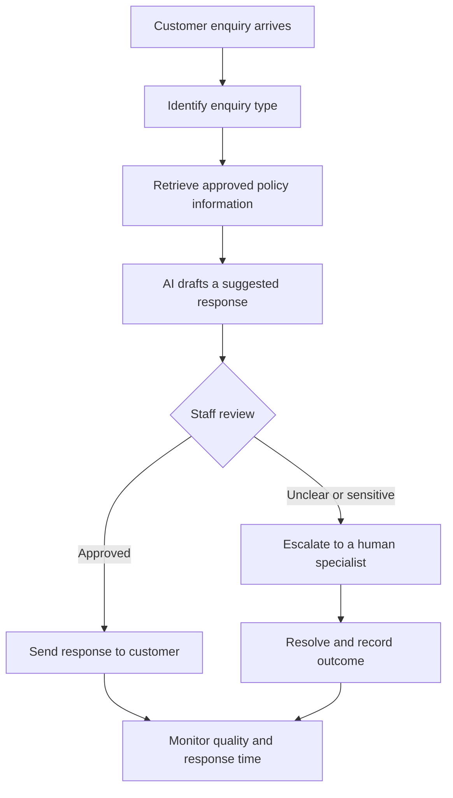

<!-- Animated header -->
<div align="center">
  

  

  <br/>
  
  
  
  
</div>

---

## 🌟 Project Overview

**AI Opportunity & Strategy** is a business-focused case study for **Horizon Retail**, a fictional retailer. The goal is to compare possible AI initiatives, choose a sensible first pilot, and explain how the business can test it safely and measure its value.

Rather than choosing AI just because it is exciting, this project uses a structured decision process: understand the business problem, assess data readiness, compare use cases, test assumptions, and create a practical implementation roadmap.

> **Main recommendation:** Pilot an AI-assisted customer-enquiry response system for routine delivery, returns, and product-policy questions. A trained staff member reviews every suggested response, and unusual or sensitive enquiries are escalated to a human.

<div align="center">
  
</div>

## 🎯 Business Case at a Glance

| Case detail | Information from the case |
|---|---|
| Organization | Horizon Retail *(fictional case organization)* |
| Store network | 12 stores |
| Annual sales | ₹30 crore |
| First-year AI budget | ₹20 lakh |
| Customer enquiries | Approximately 8,000 per month |
| Average first-response delay | 10 hours |
| Enquiries about published policies | Approximately 60% |
| Decision | Select one AI pilot to start first |

*These figures are case inputs, not independently verified company data. Proposed scores, targets, and estimates in the notebook are planning assumptions—not guaranteed outcomes.*

## 🧠 AI Opportunities Compared

The notebook compares four possible initiatives:

<table>
  <tr>
    <td width="50%"><h3>📦 Inventory Forecasting</h3><p>Forecast demand and support replenishment decisions to help reduce stockouts and write-offs.</p></td>
    <td width="50%"><h3>💬 Customer-Enquiry Assistant</h3><p>Find approved policy information and draft replies for a staff member to review.</p></td>
  </tr>
  <tr>
    <td width="50%"><h3>📈 Marketing Optimization</h3><p>Use customer and campaign data to support more relevant marketing decisions.</p></td>
    <td width="50%"><h3>👁️ Computer-Vision Store Checks</h3><p>Explore image-based support for selected shelf or store-inspection tasks.</p></td>
  </tr>
</table>

## 🏆 How the Options Are Ranked

Each use case is rated from **1 to 5** against five weighted factors. The weights total **100%**.

```text
Business value       ███████████████  30%
Data readiness       ██████████       20%
Feasibility          ██████████       20%
Risk manageability   █████████        15%
Time to value        ████████         15%
```

The project also includes a **sensitivity analysis**. It tests how the ranking changes if the customer-policy information is fragmented, outdated, or not approved for use. This helps show why the recommendation depends on checking data and policy readiness first.

## 🔄 Proposed Pilot Workflow



**Safety principle:** The AI suggests; a person decides. The pilot should use approved, current information, protect customer data, record failures, and keep the existing support process as a fallback.

## 🗓️ 90-Day Roadmap

| Phase | Timeline | Main activities | Decision gate |
|---|---|---|---|
| **1. Validate & Prepare** | Days 1–30 | Confirm owners, approve policy sources, review privacy/security, establish baseline metrics, prepare test questions. | Proceed only when policy and data readiness are acceptable. |
| **2. Build & Test** | Days 31–60 | Configure a limited prototype, test response grounding, review failures, train staff, refine escalation rules. | Proceed only if quality and safety tests pass. |
| **3. Pilot & Evaluate** | Days 61–90 | Run a controlled pilot, monitor KPIs, collect staff feedback, compare results with the baseline. | Continue, improve, or stop based on evidence. |

## 📊 What the Notebook Contains

- Executive recommendation and business problem statement
- Summary of case facts and decision boundaries
- Comparison of four AI use cases
- Data-readiness assessment
- Weighted prioritization model and score rationale
- Sensitivity analysis and conditional recommendation
- Current and proposed process diagrams
- One-page pilot charter
- 90-day roadmap and decision gates
- Proposed KPIs and measurement plan
- Limitations, learning reflection, source notes, and submission checklist

## 🛠️ Tools & Format

- **Python** — calculations and analysis in the notebook
- **Jupyter Notebook** — project narrative and reproducible analysis
- **Pandas / NumPy** — tabular data and scoring calculations, where used
- **Matplotlib** — charts, where used
- **Markdown / Mermaid** — readable documentation and workflow diagram

> The main deliverable is a Jupyter Notebook (`.ipynb`). This is a **case-based business strategy analysis**, not a trained production AI model. No raw transaction-level retail dataset is claimed to have been used.

## 🚀 Run the Project

1. Download or clone this repository.
2. Make sure Python and Jupyter Notebook are installed.
3. Open `IABAC_AI_Business_Leader_P101_Attractive.ipynb` (or the notebook filename stored in this repository).
4. Choose **Kernel → Restart Kernel and Run All Cells**.
5. Review the tables and charts from top to bottom.

If a `requirements.txt` file is included, install the listed packages first:

```bash
python -m pip install -r requirements.txt
```

Otherwise, install only the libraries imported by the notebook.

## 📁 Suggested Repository Structure

```text
IABAC-AI-Business-Leader-P101/
├── README.md
├── IABAC_AI_Business_Leader_P101_Attractive.ipynb
├── requirements.txt       # if supplied / needed
└── assets/                 # optional screenshots or project visuals
```

## ⚠️ Limitations & Responsible Use

- Horizon Retail is a fictional case organization.
- The recommendation is conditional on confirming that approved, up-to-date policy information is available.
- Scores are structured judgments; they are not measured business outcomes.
- Proposed targets must be validated during the pilot.
- Human review, privacy, security, escalation, and a fallback process are important parts of the proposed design.
- Before submitting the assessment, verify the official brief, candidate details, assessment ID, and any required declaration. Personalize the learning reflection in your own words.

## 👨‍💻 Project Details

- **Program:** IABAC Certified AI Business Leader (CAIBL AI3120)
- **Project:** P101 — AI Opportunity and Strategy
- **Case:** Horizon Retail
- **Assessment ID shown in notebook:** `E10901-PR2-V18`

---

<div align="center">
  
  <b>Business problem first. Evidence second. AI with responsibility.</b><br/>
  <sub>Created as an educational case-study project.</sub>
</div>
