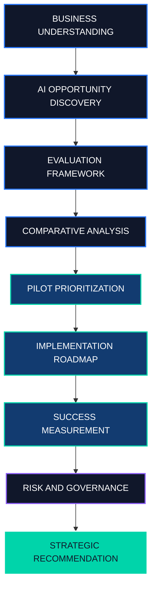

<div align="center">

# AI OPPORTUNITY & STRATEGY

### Artificial Intelligence for Business Decisions

Discover Opportunities. Analyze Business Impact. Build Smarter AI Strategies.


</div>

---


**A business-focused exploration of artificial intelligence opportunities and strategic decision-making.**

</div>

---
## 01 — Project Overview

Artificial intelligence is reshaping the way organizations operate, understand customers, analyze information, and make strategic decisions.

But the real challenge is not simply adopting AI. It is identifying **where AI can create meaningful business value**.

This project examines AI opportunities for Horizon Retail, a fictional retail organization. It explores how business challenges can be translated into potential AI initiatives and how those initiatives can be evaluated using business impact, feasibility, cost, and risk.

The goal is to develop a structured, evidence-based approach to AI strategy.

<div align="center">


</div>

## 02 — Project at a Glance

<table>
<tr>
<td width="50%" align="center">

**PROJECT DOMAIN**

Artificial Intelligence

</td>
<td width="50%" align="center">

**BUSINESS DOMAIN**

Retail Strategy

</td>
</tr>
<tr>
<td width="50%" align="center">

**ASSESSMENT**

IABAC P101

</td>
<td width="50%" align="center">

**PROJECT FORMAT**

Jupyter Notebook

</td>
</tr>
</table>

## 03 — The Business Challenge

Retail organizations work with sales records, customer interactions, purchasing histories, and inventory information.

Turning this information into effective business decisions can be difficult.

The project explores several potential opportunities:

| Business Challenge                           | Potential AI Application     |
| -------------------------------------------- | ---------------------------- |
| Uncertain product demand                     | Predictive forecasting       |
| Repetitive customer enquiries                | NLP-powered customer support |
| Limited understanding of purchasing patterns | Customer analytics           |
| Difficulty identifying relevant products     | Recommendation systems       |
| Complex operational decisions                | Predictive analytics         |

**Core question:** Which AI initiative should a business prioritize first, and how should its potential value be evaluated?

## 04 — AI Opportunity Landscape

<div align="center">


</div>

### Demand Forecasting

Analyze historical sales and relevant business information to estimate future demand.

**Potential value:** Better-informed inventory planning.

### Intelligent Customer Support

Use natural language processing to interpret questions and retrieve answers from approved information sources.

**Potential value:** More efficient handling of routine enquiries.

### Customer Analytics

Analyze purchasing behavior to identify patterns and customer segments.

**Potential value:** Better-informed customer engagement decisions.

### Recommendation Systems

Use relevant product and interaction data to recommend potentially useful products.

**Potential value:** Improved product discovery and personalization.

These are candidate opportunities. The final recommendation must be supported by the project's actual analysis.

## 05 — Strategic Workflow

<div align="center">



</div>

The workflow moves from business understanding to opportunity discovery, evaluation, prioritization, implementation planning, and strategic recommendation.

## 06 — Evaluation Framework

Every AI initiative should be assessed against consistent business criteria.

| Criterion       | Evaluation Question                                   |
| --------------- | ----------------------------------------------------- |
| Business Impact | Does it address an important business problem?        |
| Feasibility     | Are the necessary data and resources available?       |
| Cost            | What investment may be required?                      |
| Time to Value   | How quickly can the pilot demonstrate useful results? |
| Risk            | What technical, operational, and ethical risks exist? |
| Scalability     | Can the solution expand if successful?                |

The preferred initiative should balance potential value with feasibility, investment requirements, and risk.

Actual rankings should follow the notebook's analysis.

## 07 — The 90-Day Implementation Vision


### Phase 1 — Discovery

**Days 1–30**

* Define the business problem.
* Identify relevant data sources.
* Assess data quality.
* Establish baseline metrics.
* Define success criteria.

### Phase 2 — Development

**Days 31–60**

* Develop the initial pilot.
* Test the proposed approach.
* Evaluate technical performance.
* Review privacy and security.
* Gather stakeholder feedback.

### Phase 3 — Evaluation

**Days 61–90**

* Compare results against baseline metrics.
* Evaluate costs and potential benefits.
* Document limitations.
* Decide whether to improve, continue, or expand the initiative.

*This is an illustrative roadmap, not a claim that implementation has already occurred.*

## 08 — Measuring Business Success

| Area                  | Example Metric       |
| --------------------- | -------------------- |
| Demand Forecasting    | Mean Absolute Error  |
| Customer Support      | Response Time        |
| Customer Support      | Resolution Rate      |
| Recommendations       | Conversion Rate      |
| Operations            | Processing Time      |
| Financial Performance | Return on Investment |
| Reliability           | System Error Rate    |

The final metrics should match the selected initiative. Improvements must be demonstrated using actual results rather than assumed.

## 09 — Technology Stack

<div align="center">


<br/><br/>


</div>

These are relevant tools for this type of project. Confirm the exact libraries used against the notebook before presenting them as implemented technologies.

## 10 — Repository Structure

```text
AI_opportunity_and_statergy/
|
|-- IABAC_AI_Business_Leader_P101_Attractive.ipynb
|-- README.md
|
```

The notebook contains the main project analysis. Add any required datasets, reports, and supporting documents before submitting the assessment.

## 11 — Getting Started

### Clone the Repository

```bash
git clone https://github.com/govardhan-goud123/AI_opportunity_and_statergy.git
```

### Open the Project Folder

```bash
cd AI_opportunity_and_statergy
```

### Install Jupyter Notebook

```bash
pip install notebook
```

### Launch Jupyter Notebook

```bash
jupyter notebook
```

Open `IABAC_AI_Business_Leader_P101_Attractive.ipynb` and run the cells in order.

Install any additional dependencies required by the notebook before running all cells.

## 12 — Responsible AI

Responsible AI practices should be considered throughout the project lifecycle.

| Area            | Consideration                                 |
| --------------- | --------------------------------------------- |
| Privacy         | Protect confidential and personal information |
| Security        | Apply appropriate access controls             |
| Fairness        | Evaluate potential bias                       |
| Human Oversight | Retain appropriate human review               |
| Transparency    | Document assumptions and limitations          |
| Monitoring      | Track performance over time                   |
| Validation      | Test outputs before operational use           |

AI should support responsible decision-making, with appropriate human accountability.

## 13 — Key Takeaways

This project demonstrates a structured approach to evaluating AI from a business perspective.

* Begin with a clearly defined business problem.
* Identify opportunities aligned with business priorities.
* Evaluate feasibility, cost, impact, and risk.
* Validate assumptions through a controlled pilot.
* Measure outcomes against defined success criteria.
* Consider governance and responsible AI.
* Expand initiatives when evidence supports further investment.

---

## About the Author

<div align="center">


**Aspiring AI and Data Science Professional**

Interested in artificial intelligence, machine learning, natural language processing, data analysis, and practical business applications.

<a href="https://github.com/govardhan-goud123">

</a>

<br/><br/>


**AI STRATEGY | BUSINESS INTELLIGENCE | DATA-DRIVEN DECISION MAKING**

</div>
