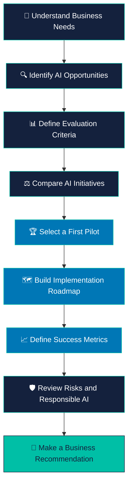

<div align="center">

# 🚀 AI OPPORTUNITY & STRATEGY

### Turning Business Problems into AI-Powered Opportunities


<br/>


<br/>

**A business-focused AI case study exploring how artificial intelligence can create measurable business value.**

</div>

---

## 📑 Table of Contents

* [🌟 Project Overview](#-project-overview)
* [🎯 Business Problem](#-business-problem)
* [💡 Project Objectives](#-project-objectives)
* [🧠 AI Opportunity Areas](#-ai-opportunity-areas)
* [⚙️ Project Workflow](#️-project-workflow)
* [📊 Evaluation Framework](#-evaluation-framework)
* [🗺️ Implementation Roadmap](#️-implementation-roadmap)
* [🛠️ Tools and Technologies](#️-tools-and-technologies)
* [📁 Project Structure](#-project-structure)
* [🚀 How to Open the Project](#-how-to-open-the-project)
* [📈 Expected Business Benefits](#-expected-business-benefits)
* [⚠️ Responsible AI](#️-responsible-ai)
* [👨‍💻 Author](#-author)

---

## 🌟 Project Overview

**AI Opportunity & Strategy** is a business case study focused on **Horizon Retail**, a fictional retail company.

The project explores how a retail business can identify useful AI opportunities, compare potential solutions, select a suitable first pilot, and plan a responsible implementation.

Instead of using AI just because it is popular, this project focuses on an important business question:

> 💭 **Which AI opportunity should a business implement first, and why?**

The goal is to connect business needs with AI solutions, measurable outcomes, implementation priorities, and responsible decision-making.

<div align="center">


</div>

---

## 🎯 Business Problem

Retail businesses face several challenges:

| Business Challenge                                  | Possible AI Opportunity                |
| --------------------------------------------------- | -------------------------------------- |
| Difficulty understanding customer needs             | Customer analytics                     |
| Uncertain future product demand                     | Demand forecasting                     |
| Time-consuming customer support                     | AI-powered support assistant           |
| Difficulty identifying business patterns            | Data analysis and predictive analytics |
| Limited ability to personalize customer experiences | Recommendation systems                 |

These are potential opportunities, not claims that Horizon Retail currently experiences every challenge.

The project considers how AI could help address relevant business problems and how the company could evaluate the potential value of each solution.

---

## 💡 Project Objectives

The project aims to:

* 🔍 Identify potential AI opportunities in retail.
* 📊 Compare AI initiatives using business-focused criteria.
* 🧠 Evaluate potential business value and implementation feasibility.
* 🏆 Recommend a suitable first AI pilot based on the analysis.
* 🗓️ Develop a phased implementation roadmap.
* 📈 Identify measurable indicators of success.
* 🛡️ Consider privacy, security, fairness, and human oversight.

---

## 🧠 AI Opportunity Areas

### 1. 📦 Demand Forecasting

**Business question:** How can a retailer better estimate future product demand?

Potential approach:

* Analyze historical sales.
* Identify seasonal patterns.
* Forecast future demand.
* Support inventory planning.

**Potential benefit:** Better-informed inventory decisions.

### 2. 🤖 AI Customer Support Assistant

**Business question:** How can a retailer answer common customer questions more efficiently?

Potential approach:

* Use natural language processing (NLP).
* Answer frequently asked questions.
* Retrieve information from approved company documents.
* Escalate complex questions to human employees.

**Potential benefit:** Faster responses to routine customer questions.

### 3. 👥 Customer Analytics

**Business question:** How can a retailer better understand customer purchasing behavior?

Potential approach:

* Analyze customer purchase patterns.
* Segment customers using suitable analytical methods.
* Identify trends in customer behavior.
* Support targeted business decisions.

**Potential benefit:** More informed customer engagement strategies.

### 4. 🎯 Product Recommendation System

**Business question:** How can a retailer recommend relevant products to customers?

Potential approach:

* Analyze historical purchases and product interactions.
* Identify product similarities.
* Generate personalized recommendations.
* Evaluate recommendation quality.

**Potential benefit:** More relevant product discovery.

> **Note:** These are example AI opportunity areas. The final recommendation should follow the evidence, criteria, and results documented in the project notebook.

---

## ⚙️ Project Workflow

<div align="center">



</div>

**Workflow explanation:**

1. Understand the business problem.
2. Identify possible AI solutions.
3. Define how the solutions will be compared.
4. Evaluate their potential value and feasibility.
5. Select a suitable pilot.
6. Plan implementation.
7. Define success metrics.
8. Review risks.
9. Present the final recommendation.

---

## 📊 Evaluation Framework

AI projects should be evaluated using business needs, not technology alone.

The following criteria can help compare candidate initiatives:

| Evaluation Criterion | Key Question                                               |
| -------------------- | ---------------------------------------------------------- |
| Business Impact      | Could this initiative solve an important business problem? |
| Feasibility          | Does the company have the data and resources needed?       |
| Cost                 | What are the estimated implementation and operating costs? |
| Time to Value        | How quickly could useful results be demonstrated?          |
| Risk                 | What technical, operational, or ethical risks exist?       |
| Scalability          | Could the solution expand after a successful pilot?        |

### 📈 Decision-Making Principle

A strong first pilot should have a clear business purpose, a realistic implementation path, measurable success criteria, and manageable risks.

**Important:** Actual scores, rankings, and the final selected initiative should be taken from the project's analysis rather than assumed in advance.

---

## 🗺️ Implementation Roadmap

The following is an illustrative 90-day roadmap. The actual schedule should be adjusted to the chosen initiative and available resources.

<div align="center">

|    Phase    |  Timeline  | Main Activities                                                 |
| :---------: | :--------: | --------------------------------------------------------------- |
|  🔍 Phase 1 |  Days 1–30 | Define the problem, review data, and establish baseline metrics |
| 🛠️ Phase 2 | Days 31–60 | Develop a pilot, test the approach, and review risks            |
|  🚀 Phase 3 | Days 61–90 | Evaluate results, gather feedback, and decide whether to expand |

</div>

### Phase 1 — Understand

* Confirm the business problem.
* Identify relevant data sources.
* Define baseline performance.
* Agree on success criteria.

### Phase 2 — Build and Test

* Develop the selected pilot.
* Test it using appropriate data.
* Review accuracy and reliability.
* Collect stakeholder feedback.

### Phase 3 — Evaluate and Improve

* Compare results with baseline metrics.
* Review costs and operational risks.
* Document lessons learned.
* Recommend whether to continue, improve, or stop the pilot.

---

## 🛠️ Tools and Technologies

The project uses a notebook-based analytical workflow.

Depending on the actual implementation, relevant tools may include:

| Tool or Technology | Purpose                              |
| ------------------ | ------------------------------------ |
| Python             | Data analysis and calculations       |
| Jupyter Notebook   | Organizing analysis and explanations |
| Pandas             | Data manipulation                    |
| NumPy              | Numerical operations                 |
| Matplotlib         | Data visualization                   |
| Seaborn            | Statistical visualization            |
| Git and GitHub     | Version control and project sharing  |

**Note:** The table lists tools relevant to this type of project. It is not a claim that every library was used in the notebook.

---

## 📁 Project Structure

The repository currently contains the following main project file:

```text
AI_opportunity_and_statergy/
│
├── IABAC_AI_Business_Leader_P101_Attractive.ipynb
│   └── Main project notebook
│
└── README.md
    └── Project documentation
```

Additional files, such as datasets, reports, or supporting documents, can be added if required by the assessment.

---

## 🚀 How to Open the Project

### Step 1 — Clone the Repository

```bash
git clone https://github.com/govardhan-goud123/AI_opportunity_and_statergy.git
```

### Step 2 — Open the Project Folder

```bash
cd AI_opportunity_and_statergy
```

### Step 3 — Install Jupyter Notebook

If Jupyter Notebook is not already installed:

```bash
pip install notebook
```

### Step 4 — Launch Jupyter Notebook

```bash
jupyter notebook
```

### Step 5 — Open the Project

Open:

`IABAC_AI_Business_Leader_P101_Attractive.ipynb`

Run the notebook cells in order and review the outputs.

**Note:** Install any additional libraries required by the notebook before running all cells.

---

## 📈 Expected Business Benefits

If an appropriately selected AI initiative is successfully implemented, potential benefits could include:

* 📦 Improved inventory planning.
* ⏱️ Reduced time spent on repetitive customer questions.
* 👥 Better understanding of customer behavior.
* 🎯 More relevant product recommendations.
* 📊 More consistent, data-informed decisions.
* 💰 Better visibility into costs and potential business value.

These are potential benefits, not measured results. They should be validated using actual project results and business metrics.

### Suggested Success Metrics

| Metric                     | What It Measures                                |
| -------------------------- | ----------------------------------------------- |
| Forecast Error             | Difference between predicted and actual demand  |
| Response Time              | Time taken to answer customer questions         |
| Resolution Rate            | Percentage of questions resolved successfully   |
| Recommendation Performance | Relevance and effectiveness of recommendations  |
| Cost per Transaction       | Cost associated with a business transaction     |
| Return on Investment       | Business value generated relative to investment |

The final metrics should match the selected AI initiative.

---

## ⚠️ Responsible AI

AI adoption should include appropriate safeguards.

* 🔒 **Privacy:** Protect customer and business information.
* 🛡️ **Security:** Restrict access to sensitive data.
* ⚖️ **Fairness:** Evaluate potential bias.
* 👤 **Human Oversight:** Allow employees to review important decisions.
* 🔍 **Transparency:** Document assumptions, limitations, and evaluation methods.
* 📊 **Monitoring:** Track performance after implementation.
* ✅ **Validation:** Test the system before relying on its outputs.

AI should support business decisions, not replace necessary human judgment.

---

## 🎓 Key Learnings

This project demonstrates a business-oriented approach to AI:

* AI projects should begin with business problems.
* Data quality influences the usefulness of AI solutions.
* Business impact and feasibility must be considered together.
* Pilot projects help validate assumptions before larger investments.
* Success should be measured using defined metrics.
* Responsible AI practices are important throughout implementation.

---

## 👨‍💻 Author

<div align="center">

### Govardhan Goud

Aspiring AI and Data Science Professional

Interested in data analysis, artificial intelligence, machine learning, natural language processing, and practical business applications.

<br/>

<a href="https://github.com/govardhan-goud123">
  
</a>

<br/><br/>

**⭐ If you find this project useful, consider giving the repository a star!**

<br/>


</div>
